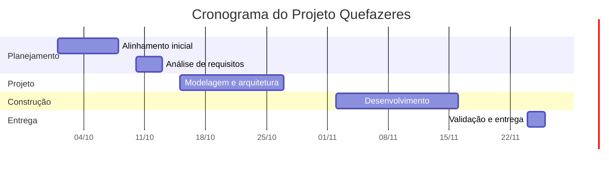
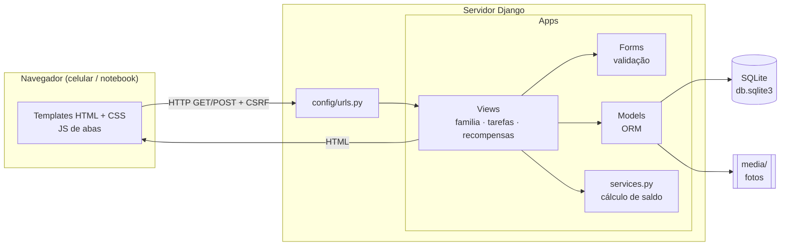
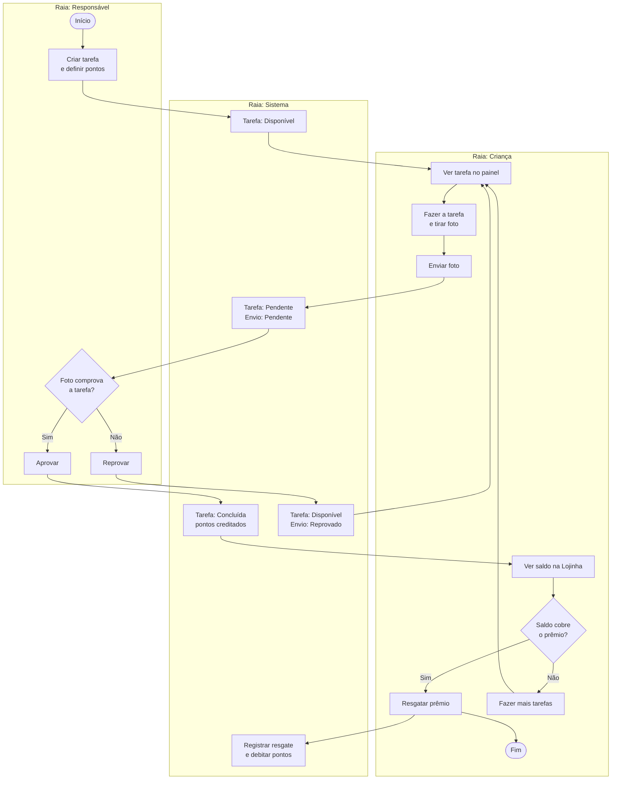
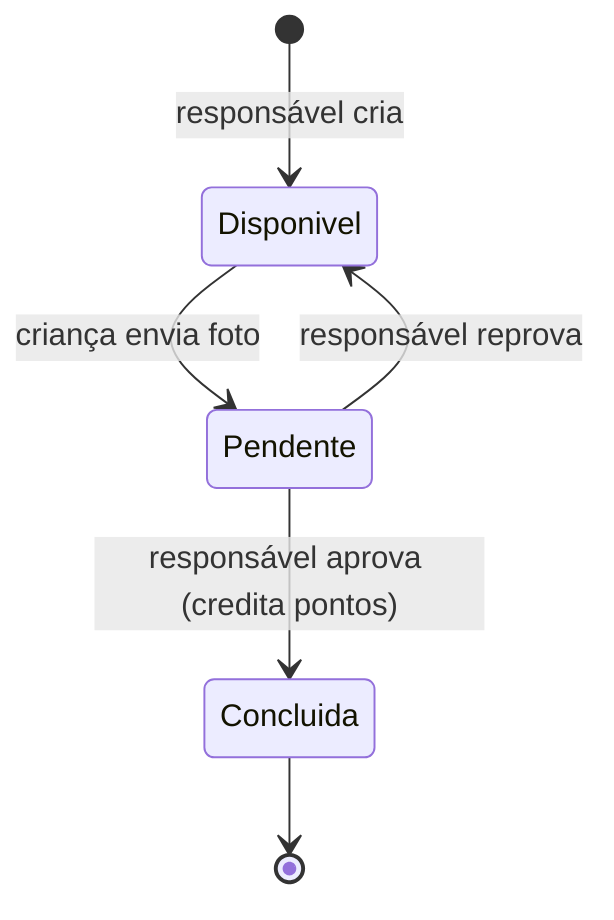
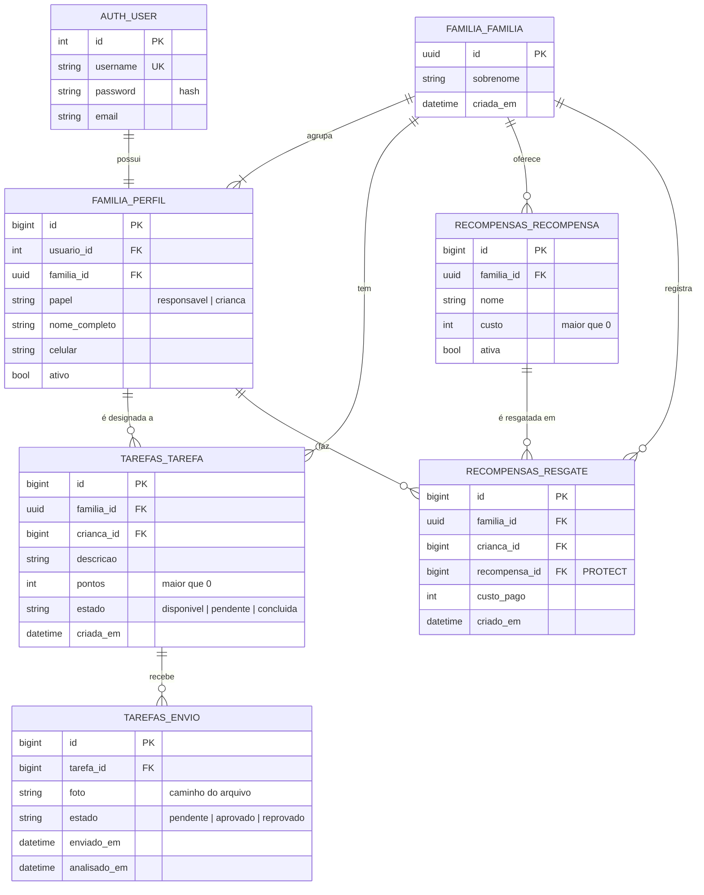
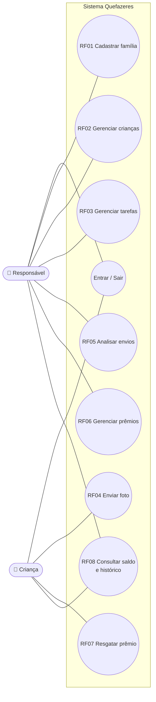
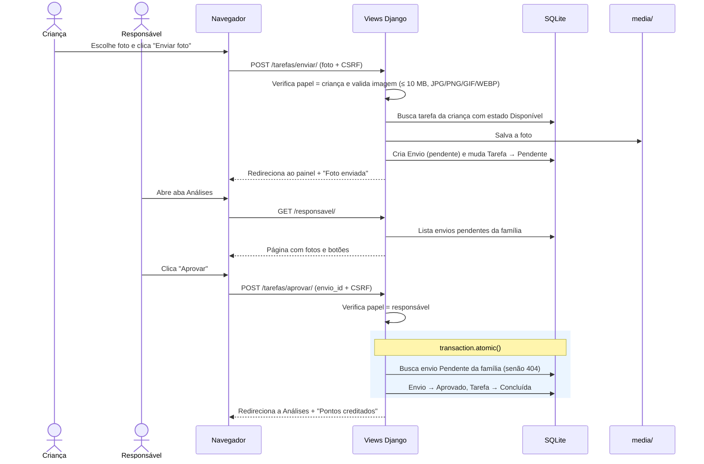
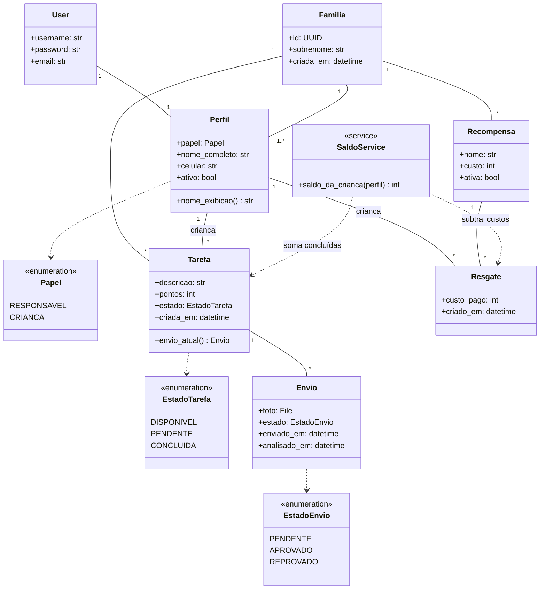

# PROJETO QUEFAZERES

**Sistema de gestão de tarefas domésticas e recompensas em família**

Organização das tarefas da casa, comprovação por foto, aprovação pelo responsável e troca de pontos por prêmios.

---

## DOCUMENTAÇÃO DO PROJETO

Escopo • Cronograma • Requisitos • Arquitetura • Protótipos de interface • Processos • Banco de dados • Diagramas UML • Testes • Execução

**EQUIPE RESPONSÁVEL**

> _Eduardo Morais_  
> _Augusto Barreto_

_Goiânia, GO | Novembro de 2026_

---

## Sumário

1. [Escopo do projeto](#1-escopo-do-projeto)
2. [Cronograma do projeto](#2-cronograma-do-projeto)
3. [Análise de requisitos](#3-análise-de-requisitos)
4. [Arquitetura do sistema](#4-arquitetura-do-sistema)
5. [Especificação das telas](#5-especificação-das-telas)
6. [Diagrama de processo (BPMN)](#6-diagrama-de-processo-bpmn)
7. [Diagrama do banco de dados](#7-diagrama-do-banco-de-dados)
8. [Diagrama de caso de uso](#8-diagrama-de-caso-de-uso)
9. [Diagrama de sequência](#9-diagrama-de-sequência)
10. [Diagrama de classes](#10-diagrama-de-classes)
11. [Plano de testes (QA)](#11-plano-de-testes-qa)
12. [Execução e implantação local](#12-execução-e-implantação-local)

---

## 1. ESCOPO DO PROJETO

O Projeto Quefazeres tem como objetivo desenvolver uma aplicação web para auxiliar famílias na organização das tarefas domésticas realizadas pelas crianças. O responsável cadastra as crianças, distribui tarefas com pontuação e cria prêmios. A criança registra a conclusão de cada tarefa com uma foto; o responsável analisa o envio e, ao aprovar, os pontos são creditados ao saldo da criança, que pode trocá-los por prêmios na "Lojinha".

A solução substitui quadros de tarefas em papel e combinados verbais por um registro único, com **rastreabilidade** de quem fez o quê, quando foi aprovado e como os pontos foram usados.

### 1.1 Objetivos e entregáveis do MVP

> **📌 OBJETIVOS OPERACIONAIS DO PRODUTO**
>
> - Vincular responsáveis e crianças a uma família identificada por um código único (UUID).
> - Distribuir tarefas com pontuação para cada criança e acompanhar seu estado em tempo real.
> - Comprovar a execução das tarefas por meio de foto, com aprovação ou reprovação pelo responsável.
> - Calcular o saldo de pontos de forma confiável e permitir a troca por recompensas.
> - Manter histórico de envios, aprovações e resgates, inclusive de contas desativadas.

O escopo segue o conceito de **MVP (Minimum Viable Product)**, focado no essencial para a demonstração acadêmica. O produto contempla cinco pilares funcionais:

- **Gestão da família:** cadastro do responsável e da família, criação, edição, desativação e reativação das contas infantis.
- **Gestão de tarefas:** criação de tarefas com descrição, criança designada e pontuação; acompanhamento dos estados _Disponível_, _Pendente_ e _Concluída_.
- **Comprovação e análise:** envio de foto pela criança e aprovação/reprovação pelo responsável.
- **Recompensas e resgates:** cadastro de prêmios com custo em pontos e resgate pela criança com validação de saldo.
- **Consulta de saldo e histórico:** saldo calculado por tarefas aprovadas menos resgates; histórico de tarefas e resgates.

### 1.2 Limites do sistema (fora do escopo)

Para evitar o crescimento indevido do escopo (_scope creep_) e cumprir o prazo da disciplina, ficam **fora** da versão inicial:

- Aplicativo móvel nativo ou híbrido (o acesso é exclusivamente Web responsivo);
- Tarefas recorrentes ou calendário automático;
- Notificações por e-mail, SMS ou push;
- Chat entre responsável e criança;
- Múltiplos níveis de aprovação ou aprovação de resgates;
- Relatórios avançados, gráficos e estatísticas;
- Sincronização offline;
- Hospedagem em nuvem e armazenamento externo de arquivos (a demonstração é feita localmente);
- Suporte técnico ou manutenção continuada após a entrega.

---

## 2. CRONOGRAMA DO PROJETO

O planejamento foi dividido em 5 fases sequenciais.

| Fase | Atividades | Período |
| --- | --- | --- |
| **1. Alinhamento inicial** | Definição da ideia, escopo e cronograma | _01/10 a 08/10_ |
| **2. Análise de requisitos** | Levantamento dos requisitos funcionais e não funcionais; regras de negócio | _10/10 a 13/10_ |
| **3. Modelagem e arquitetura** | Modelo de dados, protótipos de tela, fluxos (BPMN) e diagramas UML | _15/10 a 27/10_ |
| **4. Desenvolvimento** | Implementação em Django: apps `familia`, `tarefas` e `recompensas`; telas | _02/11 a 16/11_ |
| **5. Validação e entrega** | Testes automatizados, ajustes de usabilidade, documentação e apresentação | _24/11 a 26/11_ |



---

## 3. ANÁLISE DE REQUISITOS

Os requisitos estão divididos em **funcionais** (o que o sistema faz) e **não funcionais** (atributos de qualidade e restrições). Cada requisito apresenta descrição, dados envolvidos (com tipos) e regras de negócio.

### 3.1 Requisitos Funcionais (RF)

#### RF01 – CADASTRAR FAMÍLIA E RESPONSÁVEL

| | |
| --- | --- |
| **DESCRIÇÃO** | Permitir que um adulto crie sua conta de responsável e a família à qual as crianças serão vinculadas. |
| **DADOS** | • Nome completo: String<br>• Usuário: String<br>• Sobrenome da família: String<br>• E-mail: String<br>• Celular: String (formato `(99) 99999-9999`)<br>• Senha e confirmação: String |
| **REGRAS** | 1. O nome de usuário é único no sistema (sem diferenciar maiúsculas/minúsculas).<br>2. A senha deve atender às regras de segurança do Django (tamanho mínimo, não ser comum, não ser só numérica).<br>3. Senha e confirmação devem ser iguais.<br>4. O celular deve ter DDD e 11 dígitos.<br>5. A família recebe um identificador único (UUID) gerado automaticamente.<br>6. Família, usuário e perfil são criados numa única transação. |

_Tabela 1 – RF01: Cadastrar Família e Responsável._

#### RF02 – GERENCIAR CONTAS INFANTIS

| | |
| --- | --- |
| **DESCRIÇÃO** | Permitir que o responsável crie, edite, desative e reative as contas das crianças da sua família. |
| **DADOS** | • Nome completo: String<br>• Usuário para login: String<br>• Senha inicial: String<br>• Ativo: Boolean |
| **REGRAS** | 1. Somente o responsável cria contas infantis; a criança não cria a própria conta.<br>2. A conta infantil pertence à mesma família do responsável.<br>3. Uma conta desativada não consegue entrar no sistema.<br>4. Desativar **não apaga** tarefas, envios ou resgates (histórico preservado).<br>5. O responsável só gerencia crianças da própria família. |

_Tabela 2 – RF02: Gerenciar Contas Infantis._

#### RF03 – GERENCIAR TAREFAS

| | |
| --- | --- |
| **DESCRIÇÃO** | Permitir que o responsável crie tarefas, designe uma criança e defina a pontuação. |
| **DADOS** | • Descrição da atividade: String (até 200)<br>• Criança designada: Integer (id do perfil)<br>• Pontos: Integer<br>• Estado: String (Disponível, Pendente ou Concluída)<br>• Data de criação: DateTime |
| **REGRAS** | 1. Os pontos são inteiros maiores que zero.<br>2. Só é possível designar crianças **ativas** da própria família.<br>3. Toda tarefa nasce no estado _Disponível_.<br>4. Somente o responsável cria tarefas. |

_Tabela 3 – RF03: Gerenciar Tarefas._

#### RF04 – ENVIAR COMPROVAÇÃO

| | |
| --- | --- |
| **DESCRIÇÃO** | Permitir que a criança envie uma foto comprovando a realização da tarefa. |
| **DADOS** | • Tarefa: Integer<br>• Foto: Arquivo de imagem<br>• Data/hora do envio: DateTime<br>• Estado do envio: String (Pendente, Aprovado ou Reprovado) |
| **REGRAS** | 1. A criança só envia foto de tarefas **suas** e no estado _Disponível_.<br>2. O arquivo deve ser uma imagem JPG, PNG, GIF ou WEBP de até 10 MB; extensão e assinatura do arquivo são conferidas (SVG e outros formatos são recusados).<br>3. Após o envio, a tarefa passa para _Pendente_. |

_Tabela 4 – RF04: Enviar Comprovação._

#### RF05 – ANALISAR ENVIOS

| | |
| --- | --- |
| **DESCRIÇÃO** | Permitir que o responsável visualize a foto enviada e aprove ou reprove a tarefa. |
| **DADOS** | • Envio: Integer<br>• Decisão: String (Aprovado ou Reprovado)<br>• Data/hora da análise: DateTime |
| **REGRAS** | 1. Só é possível analisar envios _Pendentes_ da própria família.<br>2. **Aprovar** conclui a tarefa e credita os pontos **uma única vez**.<br>3. **Reprovar** não credita pontos e devolve a tarefa para _Disponível_, permitindo novo envio.<br>4. Os envios pendentes aparecem no topo de Análises, com contador no menu. |

_Tabela 5 – RF05: Analisar Envios._

#### RF06 – GERENCIAR RECOMPENSAS

| | |
| --- | --- |
| **DESCRIÇÃO** | Permitir que o responsável cadastre prêmios e seu custo em pontos. |
| **DADOS** | • Nome: String (até 120)<br>• Custo: Integer<br>• Ativa: Boolean |
| **REGRAS** | 1. O custo é inteiro maior que zero.<br>2. A recompensa pertence à família que a criou.<br>3. Somente recompensas ativas aparecem na Lojinha. |

_Tabela 6 – RF06: Gerenciar Recompensas._

#### RF07 – RESGATAR RECOMPENSAS

| | |
| --- | --- |
| **DESCRIÇÃO** | Permitir que a criança troque seus pontos por uma recompensa. |
| **DADOS** | • Criança: Integer<br>• Recompensa: Integer<br>• Custo pago: Integer<br>• Data/hora do resgate: DateTime |
| **REGRAS** | 1. O resgate só é confirmado se o saldo cobrir o custo.<br>2. O custo é registrado no momento do resgate (mudanças futuras de preço não alteram o histórico).<br>3. A criança só resgata recompensas da própria família.<br>4. A Lojinha mostra quantos pontos faltam para cada prêmio. |

_Tabela 7 – RF07: Resgatar Recompensas._

#### RF08 – CONSULTAR SALDO E HISTÓRICO

| | |
| --- | --- |
| **DESCRIÇÃO** | Permitir que a criança veja seu saldo e resgates e que o responsável veja o saldo de cada criança e o histórico de tarefas. |
| **DADOS** | • Saldo: Integer (calculado)<br>• Tarefas concluídas, envios e resgates |
| **REGRAS** | 1. Saldo = soma dos pontos das tarefas concluídas − soma dos custos pagos em resgates.<br>2. O saldo é calculado a cada consulta, evitando valores divergentes.<br>3. A criança vê apenas os próprios dados; o responsável vê apenas os da sua família. |

_Tabela 8 – RF08: Consultar Saldo e Histórico._

### 3.2 Requisitos Não Funcionais (RNF)

#### RNF01 – GARANTIR RESPONSIVIDADE

| | |
| --- | --- |
| **DESCRIÇÃO** | A interface deve funcionar bem em celulares, tablets e computadores. |
| **REGRAS** | 1. Layout em coluna única com largura máxima de 480 px e menu inferior fixo.<br>2. Botões com altura mínima de 44 px (área de toque confortável).<br>3. Acesso exclusivamente pelo navegador, sem aplicativo nativo. |

_Tabela 9 – RNF01: Garantir Responsividade._

#### RNF02 – GARANTIR SEGURANÇA

| | |
| --- | --- |
| **DESCRIÇÃO** | Proteger os dados e restringir o acesso conforme o papel (responsável ou criança) e a família. |
| **DADOS** | • Usuário e senha: String<br>• Papel: String (Responsável ou Criança)<br>• Ativo: Boolean |
| **REGRAS** | 1. Todas as telas internas exigem autenticação.<br>2. Cada ação verifica o papel **no servidor** (decorators `responsavel_obrigatorio` e `crianca_obrigatoria`).<br>3. Toda consulta é filtrada pela família do usuário autenticado.<br>4. Alterações usam POST com proteção **CSRF** e padrão Post/Redirect/Get.<br>5. Senhas são armazenadas com hash (PBKDF2, padrão do Django).<br>6. A chave secreta fica no arquivo `.env`, fora do controle de versão. |

_Tabela 10 – RNF02: Garantir Segurança._

#### RNF03 – GARANTIR USABILIDADE

| | |
| --- | --- |
| **DESCRIÇÃO** | A interface deve ser simples e amigável, especialmente para crianças. |
| **REGRAS** | 1. Navegação por menu inferior com ícones, sem recarregar a página entre as abas.<br>2. Ilustrações nas tarefas e prêmios; etiquetas coloridas de estado (Aguardando aprovação, Concluída, Tente de novo).<br>3. Mensagens de sucesso (verde), aviso (azul) e erro (vermelho) claras.<br>4. Confirmação antes de ações sensíveis (reprovar, desativar, resgatar).<br>5. Barra de progresso mostrando quanto falta para cada prêmio. |

_Tabela 11 – RNF03: Garantir Usabilidade._

#### RNF04 – GARANTIR DESEMPENHO E PORTABILIDADE

| | |
| --- | --- |
| **DESCRIÇÃO** | O sistema deve responder rapidamente e ser executável em um notebook comum. |
| **REGRAS** | 1. Banco SQLite em arquivo único, sem necessidade de servidor de banco.<br>2. Única dependência externa: Django.<br>3. Consultas usam `select_related` para evitar consultas repetidas.<br>4. Operações críticas (aprovar, reprovar, resgatar, cadastrar) rodam em transações. |

_Tabela 12 – RNF04: Garantir Desempenho e Portabilidade._

---

## 4. ARQUITETURA DO SISTEMA

O Quefazeres adota uma arquitetura **Cliente-Servidor Web monolítica** baseada no padrão **MVT (Model–View–Template)** do Django. O próprio servidor gera as páginas HTML; um pequeno script JavaScript cuida apenas da troca de abas.

### 4.1 Camadas técnicas da solução

| Camada | Tecnologia | Responsabilidade |
| --- | --- | --- |
| **Apresentação** | HTML (templates Django), CSS e JavaScript puro | Telas do responsável e da criança, menu inferior, abas sem recarregar a página |
| **Aplicação** | Python 3.14+ e Django 5.2.8 | Rotas, views, formulários, autenticação, regras de negócio e permissões |
| **Dados** | SQLite (ORM do Django) | Persistência de famílias, perfis, tarefas, envios, recompensas e resgates |
| **Arquivos** | Sistema de arquivos local (`media/`) | Armazenamento das fotos de comprovação |



_Figura 1 – Arquitetura do sistema Quefazeres._

### 4.2 Organização em apps Django

| App | Responsabilidade |
| --- | --- |
| `config/` | Configurações, rotas principais, leitura do `.env` |
| `familia/` | Família, perfis, cadastro, login, painéis e permissões por papel; comando `demo` |
| `tarefas/` | Tarefas, envios de foto, aprovação e reprovação |
| `recompensas/` | Prêmios, resgates e cálculo de saldo (`services.py`) |

### 4.3 Segurança, concorrência e auditoria

- **Segurança de acesso:** autenticação por sessão do Django, senhas com hash, proteção CSRF em todos os formulários, proteção contra _clickjacking_ e verificação de papel e família em cada view.
- **Isolamento entre famílias:** todas as consultas filtram pela família do usuário logado; tentativas de acessar dados de outra família retornam 404.
- **Concorrência:** aprovação, reprovação e resgate executam em `transaction.atomic()`; um envio só pode ser aprovado enquanto estiver _Pendente_, o que impede crédito duplo.
- **Rastro histórico:** envios guardam data de envio e de análise; resgates guardam o custo pago e a data; contas desativadas mantêm todo o histórico.

---

## 5. ESPECIFICAÇÃO DAS TELAS

A interface usa um _design system_ próprio, com paleta **azul (`#2573BD`) e verde (`#58AD71`)**, cartões com cantos arredondados, ilustrações infantis e menu inferior fixo. Etiquetas de estado seguem codificação por cores: **laranja** (Pendente / Aguardando aprovação), **verde** (Concluída / Aprovada) e **vermelho** (Reprovada / Tente de novo).

### 5.1 Telas públicas

#### 5.1.1 Tela de Entrada (Login)
Cartão de boas-vindas com a estrela do Quefazeres, formulário de usuário e senha e um cartão separado convidando novos responsáveis a criar a família. Mensagem de erro em vermelho quando as credenciais são inválidas ou a conta está desativada.

#### 5.1.2 Tela de Cadastro do Responsável
Formulário com nome completo, usuário, sobrenome da família, e-mail, celular (com máscara automática) e senha com confirmação. Erros aparecem logo abaixo de cada campo.

### 5.2 Visão do Responsável

O painel tem um **resumo no topo** (crianças, tarefas abertas, envios para analisar e prêmios) e quatro abas no menu inferior:

| Aba | Conteúdo |
| --- | --- |
| **Tarefas** | Formulário "Nova tarefa" (atividade, criança, pontos) e lista de tarefas com etiqueta de estado. |
| **Prêmios** | Formulário "Novo prêmio" (nome, custo) e lista de prêmios; resgates recentes com data. |
| **Família** | Crianças com **saldo de pontos**, botões Editar / Desativar; contas desativadas com Reativar; dados e ID da família. |
| **Análises** | Envios pendentes no topo, com foto ampliável e botões **Aprovar** (verde) e **Reprovar** (vermelho, com confirmação); histórico de tarefas abaixo. O menu mostra um contador de pendências. |

Quando ainda não há crianças, o painel exibe um guia de **Primeiros passos**.

### 5.3 Visão da Criança

| Aba | Conteúdo |
| --- | --- |
| **Tarefas** | Cartões com ilustração, pontos e estado. Tarefas disponíveis têm o botão para enviar foto (abre a câmera no celular). Tarefas reprovadas mostram "Tente de novo". |
| **Lojinha** | Grade de prêmios com ilustração e custo. Se o saldo for suficiente, aparece "Resgatar" (com confirmação); caso contrário, uma **barra de progresso** e "Faltam X pontos". Lista "Meus resgates". |
| **Perfil** | Nome, usuário, família e pontos. |

O saldo de pontos fica sempre visível no topo do painel.

---

## 6. DIAGRAMA DE PROCESSO (BPMN)

O fluxo mapeia o ciclo principal do sistema, da criação da tarefa até o resgate do prêmio, com as raias **Responsável**, **Criança** e **Sistema**.



_Figura 9 – Diagrama de processo do ciclo tarefa → aprovação → resgate (RF03 a RF07)._

### 6.1 Ciclo de vida da tarefa



_Figura 10 – Estados de uma tarefa._

---

## 7. DIAGRAMA DO BANCO DE DADOS

O banco relacional (SQLite) é gerado pelas migrações do Django. As tabelas de autenticação (`auth_user`) são do próprio Django; as demais pertencem aos apps do projeto.



_Figura 11 – Diagrama entidade-relacionamento do Quefazeres._

**Decisões de modelagem**

- O **saldo não é armazenado**: é calculado (tarefas concluídas − resgates), evitando divergências.
- `Resgate.custo_pago` guarda o preço no momento da troca, preservando o histórico.
- `Resgate → Recompensa` usa `PROTECT`: uma recompensa já resgatada não pode ser apagada.
- `Perfil.ativo` permite desativar crianças sem apagar registros.

**Migrações existentes:** `familia` (0001 a 0003), `tarefas` (0001) e `recompensas` (0001).

---

## 8. DIAGRAMA DE CASO DE USO



_Figura 12 – Diagrama de caso de uso: atores e funcionalidades (RF01 a RF08)._

O **Responsável** administra a família, as tarefas, os prêmios e as análises. A **Criança** visualiza suas tarefas, envia comprovações e resgata prêmios. Ambos consultam saldo e histórico, cada um limitado ao que lhe pertence.

---

## 9. DIAGRAMA DE SEQUÊNCIA

Sequência do fluxo principal: envio da foto pela criança e aprovação pelo responsável.



_Figura 13 – Diagrama de sequência do envio e aprovação (RF04 e RF05)._

---

## 10. DIAGRAMA DE CLASSES



_Figura 14 – Diagrama de classes do Quefazeres._

Cada `Tarefa` pertence a uma `Familia` e é designada a um `Perfil` de criança. Um `Envio` registra cada tentativa de comprovação. O `SaldoService` (`recompensas/services.py`) calcula o saldo a partir das tarefas concluídas e dos resgates.

---

## 11. PLANO DE TESTES (QA)

Os testes automatizados usam o framework de testes do Django, com banco temporário em memória (os dados reais não são afetados).

```powershell
python manage.py test familia tarefas recompensas
```

| ID | Cenário | Requisito | Resultado esperado |
| --- | --- | --- | --- |
| T01 | Painel do responsável contém as quatro abas | RNF03 | Abas Tarefas, Prêmios, Família e Análises presentes |
| T02 | Histórico fica abaixo das pendências | RF05 | Ordem correta na aba Análises |
| T03 | Responsável altera o nome da família | RF01 | Nome atualizado |
| T04 | Desativar criança sem apagar o perfil | RF02 | Perfil mantido com `ativo = False` |
| T05 | Alterar criança de outra família | RNF02 | Bloqueado (404) |
| T06 | Criança desativada tenta entrar | RF02 / RNF02 | Login recusado |
| T07 | Responsável cria tarefa | RF03 | Tarefa criada na família |
| T08 | Criança tenta criar tarefa | RNF02 | Bloqueado |
| T09 | Envio de foto deixa a tarefa pendente | RF04 | Tarefa e envio _Pendentes_ |
| T10 | Envio de arquivo que não é imagem | RF04 | Rejeitado |
| T11 | Aprovar duas vezes o mesmo envio | RF05 | Pontos creditados **uma** vez |
| T12 | Reprovar envio | RF05 | Sem pontos; tarefa volta a _Disponível_ |
| T13 | Responsável de outra família tenta aprovar | RNF02 | 404, envio inalterado |
| T14 | `envio_id` inválido | RNF02 | 404 (sem erro 500) |
| T15 | Resgate com saldo suficiente | RF07 | Resgate criado e saldo debitado |
| T16 | Resgate sem saldo | RF07 | Bloqueado |
| T17 | Resgate de prêmio de outra família | RNF02 | Bloqueado |
| T18 | `recompensa_id` inválido | RNF02 | Sem erro 500 |
| T19 | Lojinha mostra quanto falta | RF07 / RNF03 | "Faltam X pontos" |
| T20 | Superusuário sem perfil abre a página inicial | RNF02 | Vai para o `/admin/`, sem redirecionamento infinito |
| T21 | Usuário comum sem perfil abre a página inicial | RNF02 | É desconectado com mensagem clara |
| T22 | `demo --reset` recria os dados de demonstração | RNF04 | Estado inicial restaurado; outras famílias intactas |
| T23 | Envio de SVG com script | RNF02 | Rejeitado ("Formato não aceito") |
| T24 | Arquivo com extensão de imagem e conteúdo falso | RNF02 | Rejeitado (assinatura de bytes conferida) |
| T25 | Foto acima de 10 MB | RF04 / RNF03 | Rejeitada com mensagem "A foto é muito grande" |
| T26 | Foto JPG de celular (6 MB) | RF04 | Aceita |

**Resultado atual:** 26 testes executados, **todos aprovados**. `python manage.py check` sem problemas.

### 11.1 Roteiro de teste manual (apresentação)

> Antes de apresentar, execute `python manage.py demo --reset` para voltar os dados de demonstração ao estado inicial.

1. Entrar como `responsavel.demo` → ver resumo e contador "1" em Análises.
2. Em **Análises**, aprovar o envio "Organizar o quarto" da Ana → mensagem verde.
3. Em **Família**, conferir que o saldo da Ana subiu de 10 para 25 pontos.
4. Sair e entrar como `ana.demo` → ver tarefas com etiquetas e saldo no topo.
5. Na **Lojinha**, resgatar "1 hora de TV" (20 pontos) e conferir o novo saldo.
6. Enviar uma foto para "Guardar os brinquedos" → etiqueta "Aguardando aprovação".

---

## 12. EXECUÇÃO E IMPLANTAÇÃO LOCAL

A apresentação é feita em um notebook, executando o sistema localmente.

### 12.1 Pré-requisitos

- Windows com **Python 3.14** ou mais novo instalado (`py --version` no PowerShell).
- Nenhum banco de dados ou serviço extra é necessário.

### 12.2 Passo a passo (PowerShell, na pasta do projeto)

| Passo | Comando | O que faz |
| --- | --- | --- |
| 1 | `py -3.14 -m venv .venv` | Cria um ambiente isolado para as bibliotecas do projeto |
| 2 | `.\.venv\Scripts\Activate.ps1` | Ativa o ambiente (aparece `(.venv)` no início da linha) |
| 3 | `python -m pip install -r requirements.txt` | Instala o Django |
| 4 | `Copy-Item .env.example .env` | Cria o arquivo de configuração local (edite e troque a `DJANGO_SECRET_KEY`) |
| 5 | `python manage.py migrate` | Cria o banco `db.sqlite3` e as tabelas |
| 6 | `python manage.py demo` | (Opcional) Cria família, crianças, tarefas e prêmios de exemplo. Use `--reset` para recriá-los do zero (apaga só os dados de demonstração) |
| 7 | `python manage.py runserver` | Inicia o servidor |
| 8 | Abrir `http://127.0.0.1:8000/` | Usar o sistema no navegador |

> Se o PowerShell bloquear o passo 2, execute uma vez: `Set-ExecutionPolicy -Scope CurrentUser RemoteSigned`.

### 12.3 Contas de demonstração

Criadas pelo comando `python manage.py demo` (senha de todas: `demo12345`):

| Usuário | Papel | Situação inicial |
| --- | --- | --- |
| `responsavel.demo` | Responsável (família Silva) | 1 envio pendente para analisar |
| `ana.demo` | Criança | 10 pontos, 1 tarefa disponível, 1 aguardando aprovação |
| `pedro.demo` | Criança | 8 pontos, 2 tarefas disponíveis |

> Essas senhas são apenas para demonstração local. Não use em ambiente real.

### 12.4 Variáveis do arquivo `.env`

| Variável | Exemplo | Função |
| --- | --- | --- |
| `DJANGO_SECRET_KEY` | _(valor aleatório e privado)_ | Chave criptográfica do Django |
| `DJANGO_DEBUG` | `true` | Modo de desenvolvimento (mostra erros e serve as fotos) |
| `SQLITE_NAME` | `db.sqlite3` | Caminho do arquivo de banco |
| `DJANGO_ALLOWED_HOSTS` | `127.0.0.1,localhost` | Endereços aceitos pelo servidor |

### 12.5 Considerações para uma futura implantação em produção

Fora do escopo do MVP, mas mapeado para evolução: definir `DJANGO_DEBUG=false` e uma chave secreta forte; preencher `DJANGO_ALLOWED_HOSTS` com o domínio; executar `python manage.py collectstatic` (a pasta `STATIC_ROOT` já está configurada); usar um servidor WSGI (ex.: Gunicorn ou o da hospedagem); servir `media/` pelo servidor web; ativar HTTPS e cookies seguros (`SESSION_COOKIE_SECURE`, `CSRF_COOKIE_SECURE`); e usar uma hospedagem com disco persistente (ex.: PythonAnywhere) ou migrar para PostgreSQL.
